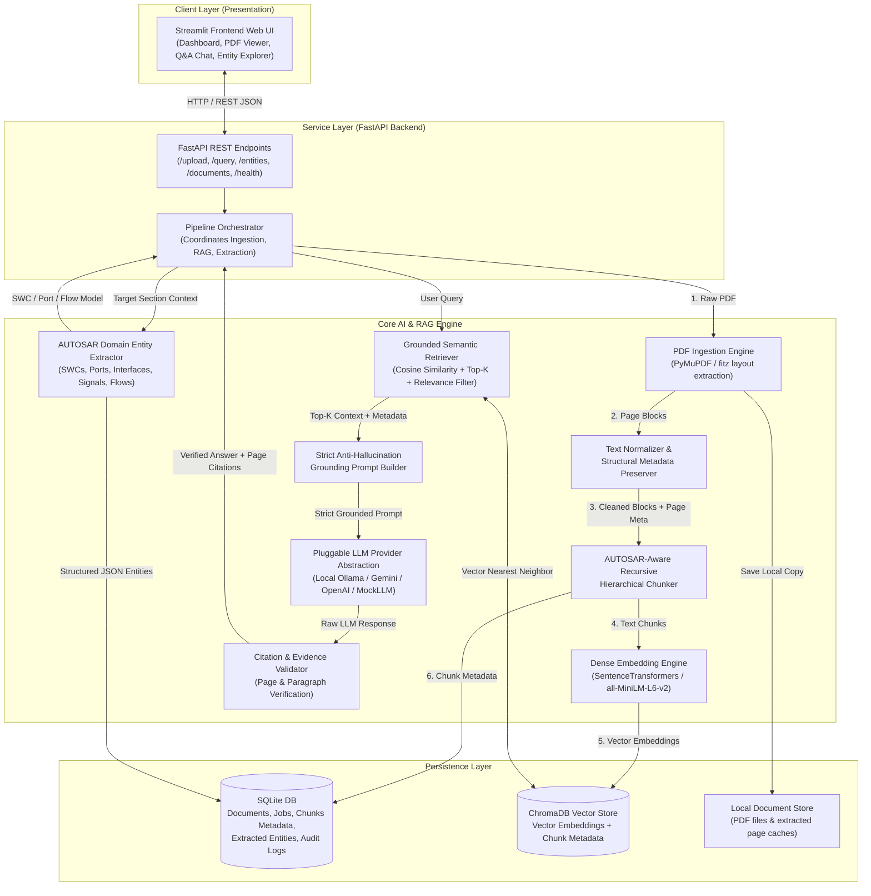
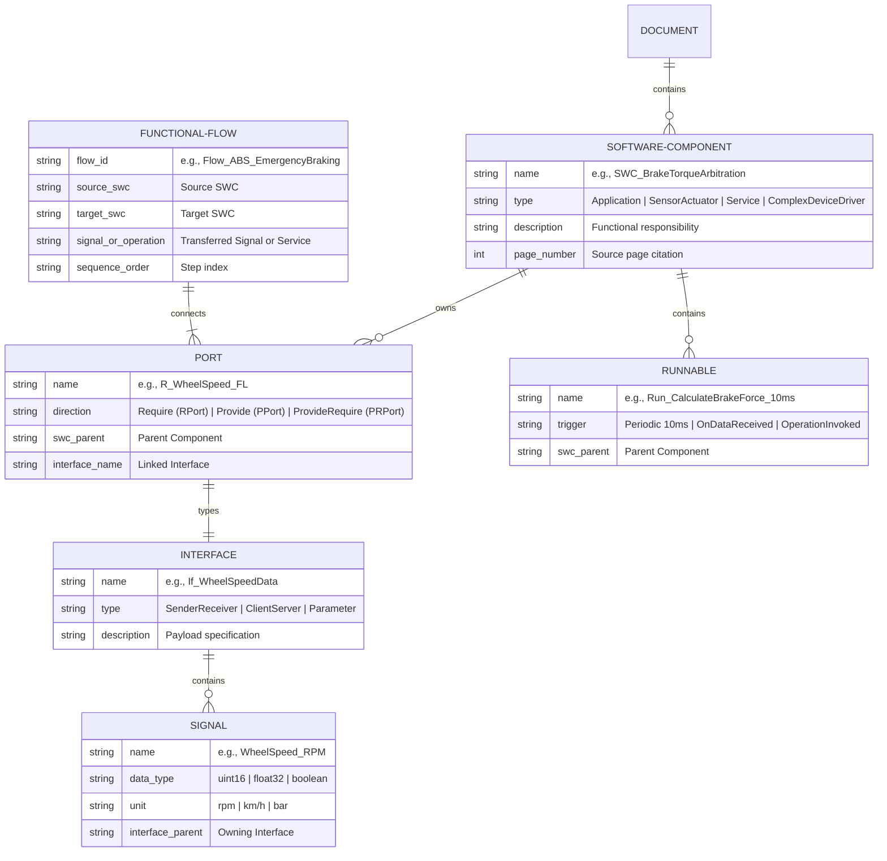

# Engineering Architecture & Implementation Plan
## Automotive Engineering AI — AUTOSAR HLD Document Analysis Assistant

---

### Executive Overview & Learning Philosophy

In automotive software engineering (ISO 26262, ASPICE, AUTOSAR Classic and Adaptive), High-Level Design (HLD) specifications define critical architectural boundaries: Software Components (SWCs), Application/Sensor-Actuator SWCs, Ports (Require `RPort`, Provide `PPort`, Provide-Require `PRPort`), Interfaces (Sender-Receiver, Client-Server, Parameter), Signals, Data Mappings, Runnables, and End-to-End (E2E) functional flows.

Engineers routinely spend dozens of hours manually verifying whether an ECU architectural design meets requirements, cross-referencing interface tables across 100+ page PDFs, and validating signal flow chains.

The goal of this project is **not** to build a throwaway demo using high-level black-box wrappers (such as `RetrievalQA.from_chain_type`), but to build a transparent, production-grade, inspectable RAG and entity-extraction pipeline from fundamental engineering primitives. Every step—from PDF layout extraction and metadata tagging to vector similarity, citation mapping, and structured domain entity extraction—will be directly inspectable and thoroughly documented.

---

## 1. System Architecture Diagram

---

## 2. Technical Decisions & Architectural Rationale

| Architecture Choice | Selected Technology | Alternative Considered | Engineering Rationale |
| :--- | :--- | :--- | :--- |
| **PDF Extraction** | **PyMuPDF (`fitz`)** | `pypdf`, `pdfplumber`, `unstructured`, OCR | PyMuPDF is implemented in C (MuPDF), achieving 10-20x faster extraction than Python-only libraries. It provides accurate bounding box coordinates, font flags (crucial for detecting AUTOSAR section headers), and page-level block extraction without heavy external dependencies. |
| **Vector Storage** | **ChromaDB (Local)** | Pinecone, Weaviate, FAISS, Qdrant | Runs completely in-process or local client mode without Docker or cloud credentials. Perfect for learning vector space indexing, collection partitioning, and SQLite-backed metadata querying while keeping automotive documents strictly local. |
| **Embedding Model** | **Sentence Transformers (`all-MiniLM-L6-v2`)** | OpenAI `text-embedding-3-small`, HuggingFace Inference API | Runs locally on CPU/GPU in milliseconds (384-dimensional dense vectors). Eliminates external API latency and rate-limiting during ingestion experiments. Consistent vector output ensures offline repeatability. |
| **LLM Provider Abstraction** | **Custom Interface (`BaseLLMProvider`)** | Hardcoded OpenAI or LangChain `BaseChatModel` | A custom 30-line protocol/ABC avoids massive dependency trees and allows instant swapping between local Ollama (`llama3`, `mistral`), Google Gemini (`gemini-2.5-flash`), OpenAI (`gpt-4o`), and offline deterministic `MockLLM` for unit testing without spending tokens. |
| **Relational Metadata** | **SQLite (`sqlite3` / SQLAlchemy)** | JSON files, Postgres, MongoDB | Automotive workflows require tracking document versions, processing jobs, extraction status, and relational entity tables (e.g., SWC has many Ports, Port has Interface). SQLite provides zero-configuration relational integrity with ACID guarantees in a single local file. |
| **Frontend/Backend Split** | **Streamlit + FastAPI** | Streamlit Monolith, React + Node | A monolithic Streamlit script mixes UI state with heavy background ML logic, causing re-runs and thread blocking. Decoupling via FastAPI enforces clean API boundaries, allows headless CLI testing, and mirrors real automotive engineering tool development. |
| **Framework Philosophy** | **Raw Primitives (No LangChain/LlamaIndex)** | LangChain, LlamaIndex, Haystack | Framework abstractions wrap core concepts in multiple layers of indirection (`PromptTemplate`, `OutputParser`, `CallbackHandler`, `VectorStoreIndexWrapper`), making it harder to learn how prompt tokens, vector distances, and citation alignments actually work. Direct Python implementations reveal the underlying mechanics. |

---

## 3. AUTOSAR Domain Entity Model

AUTOSAR software architecture follows a standardized metamodel. Our extraction pipeline will parse unstructured text and tables into the following formal schema:

---

## 4. 15-Stage Implementation Plan

Each stage defines the core concept, target files, inputs/outputs, testing strategy, and expected failure modes.

### Stage 1: Project & Environment Setup
- **Concept:** Establish a reproducible, isolated local development environment using standard Python packaging, structured directories, environment variable configuration, and dependency management.
- **Files Created/Modified:**
  - `pyproject.toml` & `requirements.txt`
  - `.env.example` & `.env`
  - `config/settings.py` (Pydantic-based configuration)
  - `core/logger.py` (Structured logging)
  - Directory structure (`backend/`, `frontend/`, `core/`, `storage/`, `tests/`, `docs/`, `data/`)
- **Inputs:** OS environment variables, configuration parameters (model choice, storage paths).
- **Outputs:** Verified virtual environment, loaded typed settings object, functioning logging system.
- **Tests:** `tests/test_config.py` (validate settings defaults, env overrides, directory auto-creation).
- **Likely Failure Modes:** Path separator discrepancies on Windows (`\` vs `/`), missing Python C++ build tools for chromadb/hnswlib, invalid `.env` types.

---

### Stage 2: PDF Ingestion (PyMuPDF Layout Parsing)
- **Concept:** Extract raw text and structural layout from complex technical PDFs while maintaining page boundaries, block coordinates, and font metadata. AUTOSAR documents contain two-column sections, parameter tables, and headers/footers that must not pollute narrative text.
- **Files Created/Modified:**
  - `core/ingestion/pdf_extractor.py`
  - `core/ingestion/models.py` (`PageContent`, `TextBlock`, `DocumentMetadata`)
- **Inputs:** PDF file path or byte stream from upload.
- **Outputs:** List of `PageContent` domain models with page numbers, bounding boxes, text blocks, and table flags.
- **Tests:** `tests/test_pdf_extractor.py` with synthetic multi-page PDF containing known headers, footers, and text blocks.
- **Likely Failure Modes:** Scanned/image-only PDFs lacking text layers (requires fallback detection), corrupted PDF structures, memory exhaustion on 500+ page specifications.

---

### Stage 3: Text Cleaning & Metadata Preservation
- **Concept:** Clean raw extracted text without destroying semantic markers. Strip repeating headers ("AUTOSAR Classic Platform 4.4.0"), footers, page numbering, and hyphenated line breaks (`compo-\nnent` -> `component`), while strictly retaining chapter hierarchy (`Section 3.2.1`), table layouts, and page numbers.
- **Files Created/Modified:**
  - `core/ingestion/cleaner.py`
- **Inputs:** Raw `PageContent` objects.
- **Outputs:** Normalized `CleanedPage` objects with structural headings, cleaned paragraphs, and attached source page identifiers.
- **Tests:** `tests/test_cleaner.py` testing hyphen unwrapping, header/footer regex removal, and section header tag retention.
- **Likely Failure Modes:** Over-aggressive regex stripping valid technical names (e.g., stripping `PPort_1` thinking it's a page number), inconsistent header layouts across different AUTOSAR specification versions.

---

### Stage 4: Structural & Semantic Chunking
- **Concept:** Standard arbitrary chunking (e.g. 500 characters) often splits a Port definition in half, destroying architectural relationships. We implement a **Structural Hierarchical Chunker** that respects AUTOSAR document headers (`1.1`, `1.2.3`), markdown/table boundaries, and falls back to sentence-boundary sliding windows with configurable overlap (e.g. 512 tokens with 64 token overlap). Every chunk retains metadata: `doc_id`, `page_number`, `section_title`, `chunk_id`, and character offsets.
- **Files Created/Modified:**
  - `core/chunking/hierarchical_chunker.py`
  - `core/chunking/models.py` (`Chunk`, `ChunkMetadata`)
- **Inputs:** `CleanedPage` sequence.
- **Outputs:** List of `Chunk` objects containing `chunk_id`, `text`, and rich metadata dictionaries.
- **Tests:** `tests/test_chunker.py` verifying that tables stay contiguous, chunk overlap works correctly, and no chunk exceeds max token limits.
- **Likely Failure Modes:** Oversized sections with no headers creating giant chunks, or tiny fragmented bullet points creating useless 5-word chunks.

---

### Stage 5: Dense Embeddings Generation
- **Concept:** Convert text chunks and user queries into dense mathematical vectors in a shared latent space using Sentence Transformers. The embedding captures technical semantics (e.g., "how is brake data transmitted" maps close to "SenderReceiver interface signal mapping").
- **Files Created/Modified:**
  - `core/embeddings/embedder.py` (`BaseEmbedder`, `SentenceTransformerEmbedder`)
- **Inputs:** Batch of strings (chunk texts or search query).
- **Outputs:** Numpy array or list of float lists representing normalized dense vectors (dim: 384 or 768).
- **Tests:** `tests/test_embedder.py` verifying vector dimensionality, L2 normalization (`norm ≈ 1.0`), and semantic similarity ordering (e.g., `cos_sim("RPort", "Require Port") > cos_sim("RPort", "Chocolate cake")`).
- **Likely Failure Modes:** Out-of-memory errors on large batch sizes, truncation of chunks exceeding embedding model token window (512 tokens for MiniLM).

---

### Stage 6: ChromaDB Vector Indexing & Persistence
- **Concept:** Store and index dense vectors with HNSW (Hierarchical Navigable Small World) graph indexing for sub-millisecond approximate nearest neighbor (ANN) search. Chunks are stored alongside their raw text and metadata in a persistent local directory (`./data/chroma_db`).
- **Files Created/Modified:**
  - `core/vector_store/chroma_manager.py`
- **Inputs:** Chunks, embeddings, metadata, collection name.
- **Outputs:** Upserted vectors in ChromaDB collection; collection statistics and query handles.
- **Tests:** `tests/test_chroma_manager.py` verifying collection creation, batch upsert, persistence across restarts, and document deletion.
- **Likely Failure Modes:** SQLite locking conflicts on concurrent writes, metadata type incompatibility (Chroma requires primitive metadata types: strings, ints, floats, bools).

---

### Stage 7: Semantic Retrieval & Relevance Filtering
- **Concept:** Given a user engineering query, generate its query embedding, retrieve the top-K nearest chunks (cosine similarity), and apply a relevance threshold filter to discard low-scoring noise. Provides metadata filtering (e.g., retrieve only from a specific document or page range).
- **Files Created/Modified:**
  - `core/retrieval/retriever.py`
  - `core/retrieval/models.py` (`RetrievedChunk`, `RetrievalResult`)
- **Inputs:** Natural language query string, top-k integer, score threshold, optional metadata filters.
- **Outputs:** Ranked list of `RetrievedChunk` instances with similarity scores, page citations, and text snippets.
- **Tests:** `tests/test_retriever.py` testing retrieval accuracy against pre-seeded mock vectors and relevance threshold cutoff behavior.
- **Likely Failure Modes:** Semantic drift where technical acronyms (e.g., "RTE", "BSW", "OS", "MCAL") retrieve generic software text rather than specific AUTOSAR architectural definitions.

---

### Stage 8: Grounded RAG Prompt Construction
- **Concept:** Assemble retrieved context into an explicit, structured prompt that enforces strict grounding. The prompt instructs the LLM: (1) Answer ONLY using the provided evidence; (2) Cite evidence using `[Page X, Section Y]` notation; (3) If the context does not contain sufficient facts, explicitly state: *"Based on the provided AUTOSAR specification, there is insufficient evidence to answer this question."*
- **Files Created/Modified:**
  - `core/rag/prompt_builder.py`
- **Inputs:** User question, list of `RetrievedChunk` items.
- **Outputs:** Formatted system and user prompt strings ready for LLM consumption.
- **Tests:** `tests/test_prompt_builder.py` verifying template injection protection, context formatting, token budget estimation, and reference numbering.
- **Likely Failure Modes:** Context window overflow when top-k chunks exceed token limits, prompt injection from maliciously crafted PDF text.

---

### Stage 9: Replaceable LLM Provider Abstraction
- **Concept:** An extensible, vendor-neutral interface (`BaseLLMProvider`) that decouples application logic from specific model APIs. Implements:
  1. `MockLLMProvider` (returns deterministic responses for unit testing without API keys).
  2. `OllamaLLMProvider` (local open-weight models like `llama3:8b`, `mistral`).
  3. `GeminiLLMProvider` (Google Gemini 2.5 Flash / Pro).
  4. `OpenAILLMProvider` (GPT-4o / GPT-4o-mini).
- **Files Created/Modified:**
  - `core/llm/base.py` (`BaseLLMProvider`, `LLMResponse`)
  - `core/llm/mock_provider.py`
  - `core/llm/ollama_provider.py`
  - `core/llm/gemini_provider.py`
  - `core/llm/openai_provider.py`
  - `core/llm/factory.py`
- **Inputs:** Formatted prompt strings, temperature, max generation tokens.
- **Outputs:** `LLMResponse` containing raw text, token counts, model metadata, and latency.
- **Tests:** `tests/test_llm_providers.py` verifying fallback behavior, mock provider returns, and error handling when an API is unreachable.
- **Likely Failure Modes:** Network timeouts, API rate limits, model hallucinations ignoring negative grounding constraints.

---

### Stage 10: Citation Generation & Evidence Verification
- **Concept:** High-integrity engineering assistants cannot provide untraceable answers. This component parses cited page tags from the LLM output, cross-checks whether the cited facts exist in the retrieved chunks, flags ungrounded statements, and generates high-fidelity citation references for the UI.
- **Files Created/Modified:**
  - `core/rag/citation_engine.py`
  - `core/rag/models.py` (`GroundedAnswer`, `Citation`)
- **Inputs:** Raw LLM response string, retrieved chunks.
- **Outputs:** `GroundedAnswer` containing answer text, list of verified `Citation` objects (page number, section, snippet, confidence score), and `is_grounded` boolean flag.
- **Tests:** `tests/test_citation_engine.py` verifying detection of fabricated page numbers and extraction of valid citation snippets.
- **Likely Failure Modes:** LLM hallucinating a page number that wasn't in the provided context, or subtle paraphrasing that fails exact string verification.

---

### Stage 11: Automotive Domain Entity & Architecture Extraction
- **Concept:** Dedicated extraction pipeline targeting AUTOSAR constructs. Uses structured output schemas (Pydantic models) to reliably extract:
  - Software Components (Type: Application, SensorActuator, Service, BSW)
  - Ports (Direction: RPort, PPort, PRPort, linked Interface)
  - Interfaces (SenderReceiver, ClientServer, fields, operations)
  - Signals (Name, Data Type, Unit)
  - Functional Flows (Source SWC -> Port -> Target SWC)
- **Files Created/Modified:**
  - `core/extraction/models.py` (Pydantic domain schemas)
  - `core/extraction/entity_extractor.py` (Rule + LLM hybrid extractor)
  - `storage/database.py` (SQLite schema & DAO for extracted entities)
- **Inputs:** Cleaned document text / targeted section chunks.
- **Outputs:** Validated Pydantic entity graphs stored in SQLite and serializable to JSON/tables.
- **Tests:** `tests/test_entity_extractor.py` against standard AUTOSAR specification excerpts containing known SWCs, Ports, and Interface tables.
- **Likely Failure Modes:** Incomplete table parsing in PDF causing missed ports, non-standard naming conventions in proprietary OEM documents.

---

### Stage 12: Streamlit Interactive Frontend
- **Concept:** A clean, responsive, multi-page engineering dashboard designed for automotive engineers.
  - Page 1: **Document Ingestion Hub** (PDF upload, ingestion progress, chunk inspector, collection stats).
  - Page 2: **Engineering RAG Assistant** (Chat interface, confidence score badges, collapsible source citation viewer with exact page snippets).
  - Page 3: **Architecture Entity Explorer** (Interactive tables for SWCs, Ports, Signals, and a Mermaid diagram viewer for functional flows).
  - Page 4: **System & Learning Diagnostics** (Inspect retrieved vectors, cosine distance metrics, and prompt token usage).
- **Files Created/Modified:**
  - `frontend/app.py` (Main Streamlit entry point)
  - `frontend/views/ingest_view.py`
  - `frontend/views/chat_view.py`
  - `frontend/views/entity_view.py`
  - `frontend/views/diagnostics_view.py`
  - `frontend/components/citations.py`
- **Inputs:** Engineer clicks, file uploads, text queries.
- **Outputs:** Rendered UI components, charts, tables, source code previews.
- **Tests:** Integration testing via Streamlit app runner (`streamlit.testing.v1`) in `tests/test_ui.py`.
- **Likely Failure Modes:** Streamlit session state loss during widget re-renders, sluggish rendering if sending large vector payloads to the frontend.

---

### Stage 13: FastAPI Service Layer
- **Concept:** Decouple business logic into a headless REST API. Exposes endpoints:
  - `POST /api/v1/documents/upload`
  - `GET /api/v1/documents`
  - `POST /api/v1/rag/query`
  - `POST /api/v1/extract/entities`
  - `GET /api/v1/entities/{doc_id}`
  - `GET /api/v1/health`
- **Files Created/Modified:**
  - `backend/main.py` (FastAPI app factory & middleware)
  - `backend/routes/documents.py`
  - `backend/routes/rag.py`
  - `backend/routes/entities.py`
  - `backend/schemas.py` (Pydantic request/response schemas)
- **Inputs:** Multipart form data (PDFs), JSON request payloads.
- **Outputs:** JSON responses with typed status, timings, citations, and entities.
- **Tests:** `tests/test_api_endpoints.py` using FastAPI `TestClient`.
- **Likely Failure Modes:** Large PDF upload timeouts, CORS errors when run on different local ports, unhandled exceptions during vector ingestion.

---

### Stage 14: Testing, Evaluation & RAG Triad Metrics
- **Concept:** Measure RAG pipeline quality systematically using the **RAG Triad**:
  1. **Context Relevance:** Did retrieval fetch chunks actually pertinent to the AUTOSAR query?
  2. **Groundedness / Faithfulness:** Is every claim in the generated answer supported by the retrieved context?
  3. **Answer Relevance:** Did the generated answer directly address the automotive engineering question?
  Maintain a "Golden Evaluation Dataset" of 10-15 standard AUTOSAR architectural questions with verified answers, ground truth citations, and entity lists.
- **Files Created/Modified:**
  - `core/evaluation/evaluator.py`
  - `core/evaluation/metrics.py`
  - `data/golden_dataset.json`
  - `tests/test_evaluation.py`
- **Inputs:** Evaluation queries, ground truth answers, pipeline predictions.
- **Outputs:** Scorecard table (Context Relevance %, Groundedness %, Citation Accuracy %).
- **Tests:** Automated regression test suite executing `pytest tests/`.
- **Likely Failure Modes:** Subjective evaluation variance when using LLM-as-a-judge; edge cases where valid domain inferences are penalized as hallucinations.

---

### Stage 15: Demo Preparation & Sample Automotive Corpus
- **Concept:** Curate a realistic sample AUTOSAR High-Level Design document (e.g. Adaptive/Classic Platform Braking Control & Body Controller design specification) with clear SWC diagrams, Port tables, and Sender-Receiver interfaces. Prepare an end-to-end scripted verification walkthrough demonstrating ingestion, question answering with page verification, entity extraction, and negative grounding ("insufficient evidence").
- **Files Created/Modified:**
  - `data/samples/AUTOSAR_HLD_Sample_BrakingSystem.pdf` (or markdown/pdf generator)
  - `scripts/seed_demo_data.py`
  - `scripts/run_demo.bat` / `scripts/run_demo.sh`
  - `DEMO_SCRIPT.md` (Step-by-step presentation walkthrough)
- **Inputs:** Sample document and scripted queries.
- **Outputs:** Pre-indexed, validated local system ready for instant live demonstration.
- **Tests:** End-to-end smoke test validating all views in less than 5 seconds.
- **Likely Failure Modes:** Live demo failure due to missing API keys or unstarted Ollama service (mitigated by pre-configured `MockLLM` fallback).

---

## 5. Scope Boundaries: MVP (2-Day Demo) vs. Future Phases

### Required MVP Features (Target: 2-Day Working Demo)
1. **Single-command local launch:** Automated startup of FastAPI and Streamlit.
2. **Local PDF Ingestion:** Upload an AUTOSAR HLD PDF, extract text with page coordinates using PyMuPDF.
3. **Structured Chunking & Embedding:** Ingest into ChromaDB with metadata (page number, section).
4. **Strict Grounded Q&A:** Answer engineering queries with explicit page citations (`[Page X]`).
5. **Admit Ignorance:** If asked about an unrelated topic or missing feature, state: *"Insufficient evidence in document."*
6. **Core Entity Extraction Table:** Extract SWCs, Ports, and Interfaces into a clean interactive UI table.
7. **Replaceable LLM Provider:** Working Mock Provider for offline testing, plus Gemini / Ollama / OpenAI provider.
8. **Interactive UI:** Streamlit interface with Document Upload, Q&A Chat, and Entity Table.
9. **Zero-Fluff Educational Documentation:** Complete `README.md`, `ARCHITECTURE.md`, `LEARNING.md`, `RAG_PIPELINE.md`, `EVALUATION.md`, `SECURITY.md`.

### Future Engineering Enhancements (Post-Demo)
- Hybrid BM25 + Dense Vector Search (Reciprocal Rank Fusion) for exact keyword acronym matching (`CanNm`, `ComM`).
- Complex Vector Table Extraction using table structure recognition models (e.g., Table Transformer).
- Interactive 2D Graph Visualizer for SWC Port connections (using PyVis / Cytoscape).
- Multi-document cross-referencing (comparing Low-Level Design against High-Level Design).
- ARXML (AUTOSAR XML) file ingestion and dual-validation against PDF documentation.
- Fine-grained role-based access control and encrypted vector storage.

---

## 6. Security, Privacy & Automotive Compliance Considerations

1. **Strict Local Processing (Data Privacy):** Automotive OEMs and Tier-1 suppliers classify HLD specifications as strictly confidential IP. This prototype defaults to local storage (`./data`), local embeddings (`SentenceTransformers`), local vector store (`ChromaDB`), and supports completely air-gapped local LLMs (`Ollama`), preventing any confidential engineering data from leaving the workstation.
2. **No Persistent External Logs:** When using external providers (e.g., Gemini or OpenAI), zero-data-retention parameters are flagged.
3. **Prompt Injection Hardening:** Automotive PDFs may contain text strings that resemble instruction overrides. System prompts strictly separate user input and untrusted context using XML-style delimiters (`<context>` ... `</context>`).
4. **Input Sanitization & Path Traversal:** File upload endpoints validate file headers (magic bytes `%PDF`) and strictly sanitize filenames to avoid directory traversal (`../../etc/passwd`).

---

## 7. Assumptions Regarding Sample Automotive Documents

1. **Text Layer Availability:** We assume sample documents have standard embedded digital text layers (not purely bitmap scans of printed paper requiring OCR).
2. **Standard AUTOSAR Terminology:** Documents utilize standard naming conventions (SWC, RPort, PPort, Interface, Signal, Runnable) defined by AUTOSAR Classic (v4.x) or Adaptive standards.
3. **Language:** Ingestion and prompts target English technical documentation.
4. **Table Formatting:** Parameter and signal mapping tables are rendered using standard vector table rules or structured paragraph blocks rather than nested graphical charts.
