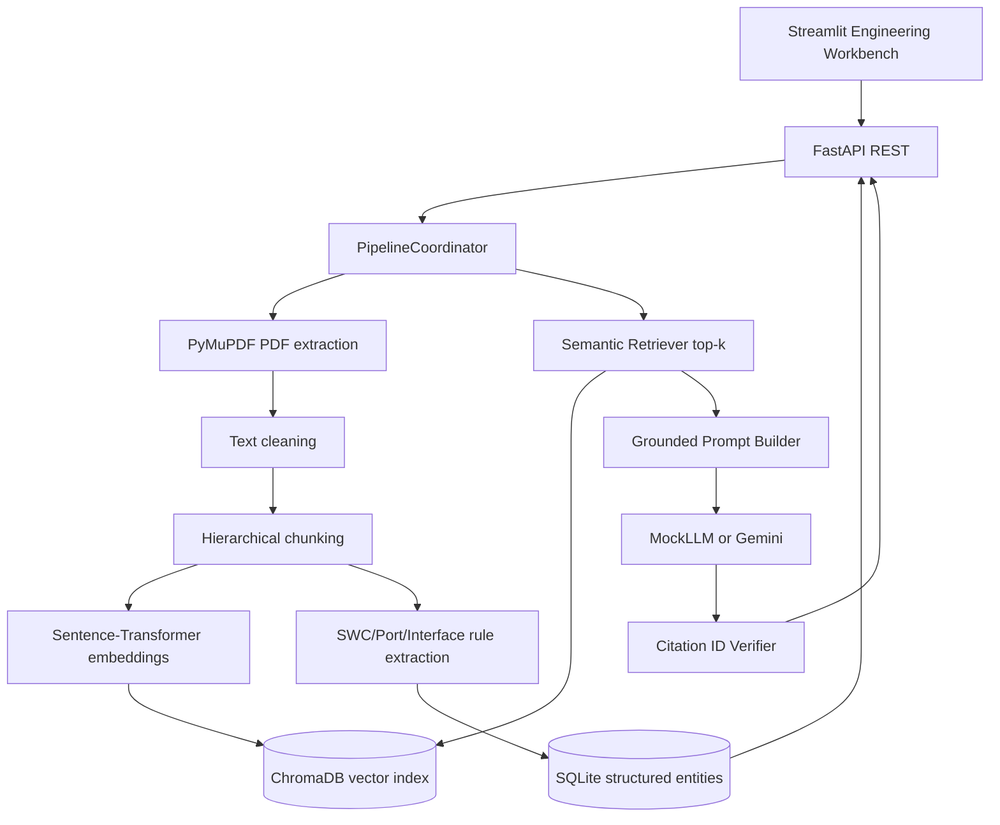

# Architecture and Workflows

**Ingestion:** PDF → page/block text → cleaning → chunks → embeddings → vector index + deterministic entity extraction → SQLite.

**Q&A:** question → query embedding → ChromaDB nearest neighbors → grounded prompt → provider → cited answer → Python citation validation → answer/evidence in Streamlit.

**Source of truth:** [backend/coordinator.py](../backend/coordinator.py), [core/rag](../core/rag), [frontend/app.py](../frontend/app.py).

The citation check validates the *reference ID*, not semantic entailment. Human reviewers must open the cited source before accepting engineering claims.
